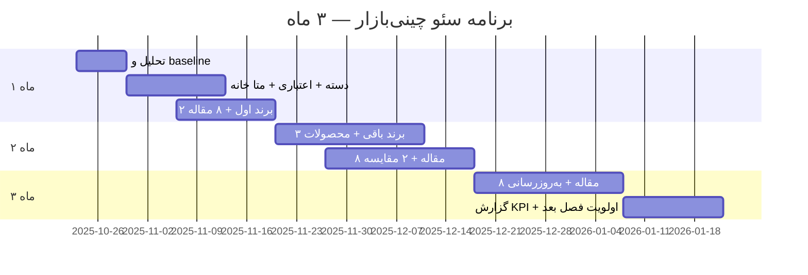

# برنامه سه‌ماهه سئو و محتوا — چینی‌بازار

**سند:** ارائه به مدیریت  
**دامنه:** chinibazar.ir  
**پلتفرم:** Laravel  
**دوره پیشنهادی:** آبان ۱۴۰۵ — دی ۱۴۰۵ (۱۲ هفته)  
**نسخه:** ۱.۰

---

## خلاصه اجرایی (یک صفحه)

چینی‌بازار در بازار سرویس چینی با فروشگاه‌های **نیک چینی، پردیس چینی و چینی زرین** رقابت می‌کند. محصولات فروشگاه روی **پنج برند لورین، والاس، فالکن، هرمیتاژ و پردیس** متمرکز است؛ **چینی زرین رقیب است و در سایت عرضه نمی‌شود.**

این برنامه **سه ماه** روی آنچه مستقیماً به **فروش از گوگل** کمک می‌کند تمرکز دارد: صفحات دسته و اعتباری، صفحات برند، بهینه‌سازی محصولات موجود، مجله هدفمند و لینک‌سازی داخلی. پیاده‌سازی در **Laravel** (صفحات CMS، روت برند، بخش مجله، قالب متا برای محصول) در نظر گرفته شده است. **پروژه جداگانه سئوی فنی** (سرعت، crawl، schema پیشرفته) در این سند لحاظ نشده تا تیم روی خروجی محتوا و فروش متمرکز بماند.

| مورد | هدف پایان ماه ۳ |
|------|------------------|
| صفحات استراتژیک جدید/بازنویسی | ۸+ (دسته، اعتباری، ۵ برند، درباره/اعتماد) |
| محصولات با توضیح سئو اختصاصی | ۸۰٪ موجودی فعال (حداقل) |
| مقالات مجله | ۲۴ مقاله (۲ در هفته) |
| صفحات مقایسه/راهنمای خرید | ۶+ |
| ورودی ارگانیک | رشد نسبت به baseline ماه ۱ (ثبت در KPI) |
| سفارش منسوب به ارگانیک | ردیابی با UTM / سوال سفارش |

---

## ۱. اهداف SMART (سه ماه)

1. **دیده‌شدن تجاری:** حضور در نتایج برای ترکیب «سرویس چینی + [برند]» و «خرید/قیمت سرویس چینی».  
2. **تمایز:** صفحه «خرید اعتباری/اقساطی» به‌عنوان مسیر ثابت از دسته، برند و مقالات.  
3. **تبدیل:** هر صفحه برند و هر مقاله pillar حداقل یک CTA خرید و یک مسیر به اعتباری.  
4. **اندازه‌گیری:** baseline در هفته ۱ (ترافیک، صفحات برتر، تعداد محصولات فعال) و گزارش ماهانه با [`KPI-REPORT-TEMPLATE.md`](KPI-REPORT-TEMPLATE.md).

---

## ۲. محدوده کار (Scope)

### داخل برنامه

- استراتژی کلیدواژه و نقشه صفحات ([`SEO-STRATEGY.md`](SEO-STRATEGY.md))  
- متن و ساختار: صفحه اصلی (متا + بلوک‌های پیشنهادی)، دسته **سرویس چینی**، **خرید اعتباری**، **۵ صفحه برند**  
- بازنویسی توضیح محصول (عنوان سئو، خلاصه، FAQ تکراری در سطح برند)  
- راه‌اندازی/تثبیت **مجله راهنمای خرید** در Laravel  
- تقویم ۲۴ محتوا + ۶ محتوای مقایسه/ pillar  
- لینک‌سازی داخلی (قوانین ثابت در انتهای هر محتوا)  
- تحلیل رقبا شامل **چینی زرین** (فقط intelligence، بدون محتوای محصول)

### خارج از برنامه (فاز بعد / تیم فنی جدا)

- بهینه‌سازی سرعت، زیرساخت CDN، ممیزی Screaming Frog  
- کمپین لینک‌سازی خارجی گسترده  
- گسترش دسته‌های بلور، مبلمان (پس از تثبیت سرویس چینی)

---

## ۳. فازبندی سه ماه

> تاریخ‌های نمودار نمایشی هستند؛ در اجرا از **هفته ۱ تا ۱۲** تقویم [`content-calendar/`](content-calendar/) پیروی کنید.

### ماه ۱ — «پایه فروش» (هفته ۱–۴)

**شعار:** قبل از حجم مقاله، صفحاتی که پول می‌آورند.

| خروجی | جزئیات |
|--------|---------|
| Baseline | ثبت ترافیک، ۲۰ URL مهم، لیست محصولات فعال به تفکیک برند |
| صفحه دسته سرویس چینی | H1، ۶۰۰+ کلمه، FAQ، لینک ۵ برند |
| صفحه خرید اعتباری | دیجی‌پی / تارا / باجت (فقط روش‌های فعال)، FAQ، لینک به دسته |
| صفحات برند | **لورین** و **والاس** (کامل طبق استاندارد استراتژی) |
| مجله | راه‌اندازی آرشیو + ۸ مقاله (راهنمای خرید، بهترین برند، قیمت، ۶ vs ۱۲، جهیزیه، اقساطی، معرفی لورین/والاس) |
| محصول | ۲۰ محصول پرفروش: متن اختصاصی |

**معیار موفقیت ماه ۱:** ۲ صفحه pillar + ۲ برند + ۸ مقاله منتشر؛ لینک داخلی از همه مقالات به دسته و اعتباری.

---

### ماه ۲ — «تسلط برند و مقایسه» (هفته ۵–۸)

**شعار:** پوشش کامل برندها + گرفتن جست‌وجوی مقایسه‌ای.

| خروجی | جزئیات |
|--------|---------|
| صفحات برند | **فالکن، هرمیتاژ، پردیس** |
| محصول | ۴۰ محصول دیگر (جمع ≈ ۶۰ یا ۸۰٪ موجودی) |
| مقالات | ۸ مقاله: معرفی هر برند باقی‌مانده + «مقایسه لورین و والاس» + «فالکن vs هرمیتاژ» + «قیمت و عوامل مؤثر» |
| لندینگ اعتماد | متن «ضمانت اصالت، ارسال، شکستگی» (صفحه ثابت یا بخش درباره ما) |
| رقبا | یک‌برگه داخلی: نقاط قوت/ضعف نیک چینی، پردیس چینی، **چینی زرین** (بدون انتشار عمومی اگر نخواهید) |

**معیار موفقیت ماه ۲:** ۵/۵ صفحه برند live؛ حداقل ۲ مقاله مقایسه؛ ۶۰+ محصول با توضیح سئو.

---

### ماه ۳ — «توسعه و بهینه» (هفته ۹–۱۲)

**شعار:** تقویت برنده‌های برنده + آماده‌سازی فصل بعد.

| خروجی | جزئیات |
|--------|---------|
| مقالات | ۸ مقاله: طلایی/پلاتین، چینی vs آرکوپال، ظروف چینی، مقایسه ایرانی/خارجی، خرید اعتباری (عمیق)، پردیس (تمایز با رقیب)، long-tail جهیزیه |
| به‌روزرسانی | ۵ صفحه/مقاله با بیشترین impression (عنوان و متا و CTA) |
| محصول | باقی‌مانده موجودی + یک‌بار FAQ یکپارچه در برندها |
| گزارش | KPI سه ماه + پیشنهاد اولویت ماه ۴–۶ (بلور، لینک خارجی، و…) |

**معیار موفقیت ماه ۳:** ۲۴ مقاله cumulative؛ گزارش مدیریتی؛ لیست ۱۰ کلیدواژه برتر با وضعیت رتبه.

---

## ۴. تقویم محتوا (خلاصه ۱۲ هفته)

| هفته | محتوای اصلی | نوع |
|------|-------------|-----|
| ۱ | Baseline + دسته سرویس چینی + صفحه اعتباری | صفحه فروش |
| ۲ | راهنمای خرید سرویس چینی + بهترین برندهای سرویس چینی | مجله |
| ۳ | معرفی لورین + معرفی والاس | مجله + لینک برند |
| ۴ | سرویس ۶ نفره یا ۱۲ نفره؟ + قیمت سرویس چینی | مجله |
| ۵ | معرفی فالکن + معرفی هرمیتاژ | مجله |
| ۶ | مقایسه لورین و والاس + خرید سرویس چینی اقساطی (تکمیل) | مجله |
| ۷ | معرفی پردیس + راهنمای جهیزیه | مجله |
| ۸ | قیمت و عوامل مؤثر + مقایسه فالکن و هرمیتاژ | مجله |
| ۹ | طرح طلایی و پلاتین + تفاوت چینی و آرکوپال | مجله |
| ۱۰ | ظروف چینی + مقایسه برندهای ایرانی (بدون تبلیغ زرین) | مجله |
| ۱۱ | خرید با اعتبار بانکی + «چرا چینی‌بازار» (اعتماد) | مجله + صفحه |
| ۱۲ | جمع‌بندی + به‌روزرسانی Top 5 + گزارش KPI | عملیات |

جزئیات روزانه/مسئول: [`content-calendar/month-01.md`](content-calendar/month-01.md) و ماه‌های ۲ و ۳.

---

## ۵. نقش‌ها و زمان (برآورد تیم)

| نقش | مسئولیت | مشارکت تقریبی |
|-----|---------|----------------|
| مدیر محصول / مدیریت | تأیید اولویت، روش‌های اعتباری، قیمت | ۲ ساعت/هفته |
| تولیدکننده محتوا | مقالات، متن برند، FAQ | ۲۴ مقاله + ۵ برند |
| کارشناس سئو/محتوا | کلیدواژه، لینک داخلی، KPI | ۸–۱۲ ساعت/هفته |
| توسعه‌دهنده Laravel | روت برند، مجله، فیلدهای متا محصول | ۳–۵ روز‌کاری در ماه ۱؛ ۱–۲ روز/ماه بعد |
| عکاسی/محصول | تصویر واقعی برندها | batch در هفته ۱–۲ |

---

## ۶. وابستگی به Laravel (بدون سئوی فنی)

| قابلیت | کاربرد سئو |
|--------|------------|
| مدل `Page` یا ماژول CMS | دسته، اعتباری، برند |
| `slug` یکتا + `meta_title` / `meta_description` | همه صفحات |
| روت `/brand/{slug}` | ۵ برند |
| بخش `Blog` / `Magazine` | ۲۴ مقاله |
| فیلدهای SEO روی `Product` | توضیح، FAQ، canonical دستی در صورت نیاز |
| Blade component برای FAQ و CTA اعتباری | یکنواختی |

---

## ۷. شاخص‌های کلیدی (KPI)

### ۷.۱ ماهانه

| شاخص | ماه ۱ | ماه ۲ | ماه ۳ |
|------|-------|-------|-------|
| مقالات منتشر شده (تجمعی) | ۸ | ۱۶ | ۲۴ |
| صفحات برند کامل | ۲ | ۵ | ۵ |
| محصولات با متن سئo | ۲۰ | ۶۰ | ۸۰٪+ |
| ورودی ارگانیک (sessions) | baseline + ۱۵٪ | +۳۰٪ نسبت baseline | +۵۰٪ |
| کلیک از برندها (GA4) | ثبت | رشد | رشد |
| سفارش با medium=organic | ثبت | رشد | رشد |

*درصدها پس از ثبت baseline هفته ۱ معنی‌دار می‌شوند؛ عدد مطلق رتبه بدون ابزار رتبه‌یاب قابل تعهد نیست.*

### ۷.۲ گزارش‌دهی

- **هفتگی:** چک‌لیست تقویم (۵ دقیقه)  
- **ماهانه:** تکمیل [`KPI-REPORT-TEMPLATE.md`](KPI-REPORT-TEMPLATE.md)  
- **پایان ماه ۳:** ارائه ۳۰ دقیقه به مدیریت + پیشنهاد فاز بعد

---

## ۸. ریسک‌ها و راه‌حل

| ریسک | احتمال | اقدام |
|------|--------|--------|
| کمبود تصویر واقعی | بالا | batch عکاسی هفته ۱–۲؛ موقت از تصاویر رسمی برند با مجوز |
| صفحات برند تکراری | متوسط | چک‌لیست یکتا بودن ۳۰٪ متن + جدول محصول متفاوت |
| اشتباه پردیس چینی vs برند پردیس | متوسط | H1: «خرید از چینی‌بازار» + FAQ |
| تأخیر توسعه Laravel | متوسط | اول محتوا در markdown ریپو؛ انتشار batch پس از روت |
| انتظار نتیجه زودهنگام | بالا | گزارش baseline و تأکید افق ۳–۶ ماه برای رتبه‌های عمومی |

---

## ۹. بودجه (قالب — اعداد توسط مالی تکمیل شود)

| ردیف | شرح | ماه ۱ | ماه ۲ | ماه ۳ |
|------|-----|-------|-------|-------|
| ۱ | تولید محتوا (خارجی/داخلی) | | | |
| ۲ | عکاسی محصول | | | |
| ۳ | توسعه Laravel (ساعتی) | | | |
| ۴ | ابزار (رتبه/Analytics در صورت نیاز) | | | |
| **جمع** | | | | |

---

## ۱۰. تأیید مدیریت

| نقش | نام | تاریخ | امضا |
|-----|-----|-------|------|
| مدیر عامل / مالک | | | |
| مدیر فروش | | | |
| مسئول پروژه سئو | | | |

---

## پیوست: چک‌لیست شروع (۹ مورد)

- [ ] ثبت baseline ترافیک و فروش ارگانیک  
- [ ] تحلیل رقبا (نیک چینی، پردیس چینی، **چینی زرین**)  
- [ ] انتشار/بازنویسی دسته **سرویس چینی**  
- [ ] انتشار صفحه **خرید اعتباری**  
- [ ] صفحات برند: لورین، والاس، فالکن، هرمیتاژ، پردیس  
- [ ] بهینه‌سازی محصولات (پیشرفت ۸۰٪)  
- [ ] مجله راهنما + ۲ مقاله/هفته  
- [ ] لینک داخلی استاندارد روی همه محتوا  
- [ ] گزارش KPI پایان ماه ۳  

---

*مستندات تکمیلی: [`README.md`](README.md) · [`SEO-STRATEGY.md`](SEO-STRATEGY.md)*
